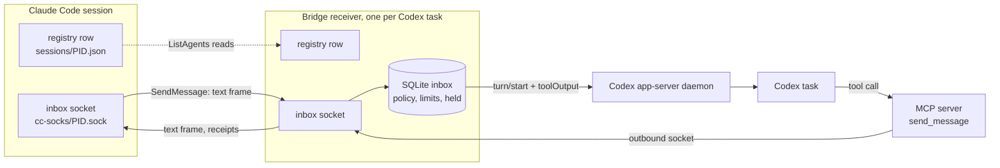

# Claude UDS Bridge

A Codex plugin that lets Codex tasks and Claude Code sessions message each other on one machine.

Claude Code lists and messages its other sessions through its own local registry. This plugin registers each Codex task in that registry, so Claude finds the task with `ListAgents` and writes to it with `SendMessage`. Claude needs no flags, plugins, or launchers. A bundled MCP server gives the Codex side `list_sessions` and `send_message`. Messages travel over Unix domain sockets in private per-user directories.

## Requirements

- Stock Codex with its shared local app-server daemon. CLI tasks on the daemon and desktop tasks it owns work. Older desktop tasks use the desktop IPC fallback. CLI sessions started with `--no-daemon` have no inbox. Real-runtime checks cover Codex 0.159.0, 0.159.2, and 0.159.3.
- macOS or Linux.
- Claude Code 2.1.224 or later, the first release with [cross-session messaging](https://code.claude.com/docs/en/cross-session-messaging).
- Bun on your `PATH`.

## Install

```bash
codex plugin marketplace add LeonKohli/claude-uds-bridge
codex plugin add claude-uds-bridge@leonkohli
```

The ByMedion fork supports Desktop stream versions 11 and 13, adds receiver diagnostics and recovery, and supports native queue delivery on Desktop v13. Other stream versions are rejected. See [Desktop compatibility](plugins/claude-uds-bridge/DESKTOP-COMPATIBILITY.md) for the evidence and limits.

To install this fork from a local checkout:

```bash
codex plugin marketplace add /absolute/path/to/claude-uds-bridge
codex plugin add claude-uds-bridge@leonkohli
```

The fork keeps the upstream marketplace name `leonkohli`, so the plugin retains its existing identity when its source changes to the local checkout. Restart Codex after updating an already loaded plugin.

If `leonkohli` is already configured from another source, run `codex plugin marketplace remove leonkohli` before adding the local checkout.

The plugin is not in the public Plugin Directory. As of 2026-10-03, OpenAI's [submission rules](https://developers.openai.com/plugins/deploy/submission) reject plugins with lifecycle hooks and accept only hosted HTTPS MCP servers. This plugin needs a `SessionStart` hook and a local MCP server, because the sockets and registry it uses live on your machine. It installs through its own marketplace until those rules change.

Codex ignores plugin hooks until you trust them. Open the plugin in Codex, review the two hooks, and confirm both. Then open a new task. Tasks that were already open keep running without the hooks.

A task registers when its `SessionStart` hook runs, which Codex does on the first turn. A fresh chat with nothing typed stays invisible to Claude. See [STARTUP.md](plugins/claude-uds-bridge/STARTUP.md).

## Check that it works

In the Codex task, ask for the bridge status. The `status` tool reports a `replyAddress` and a `transport` of `app-server` or `desktop`. A `null` address means the receiver is inactive. Check hook trust and the hook result.

In Claude Code, run `/list-agents`. The task appears as `codex-<directory>-<suffix>`. Ask Claude to message it.

## How a message arrives

A message steers the task's active turn, or starts a turn when the task is idle. A running tool is never interrupted. The bridge marks the text as peer input. It grants no approval, and the task's own permissions still apply.



The app-server transport uses `turn/start` with `toolOutput`, which starts or joins a turn at tool authority. The bridge reads existing settings and leaves approval requests to your UI. If the observer connection drops, status and permissions are `unknown` while the bridge reconnects for up to 30 seconds. If recovery fails, the receiver exits. A lost delivery acknowledgement stays `unknown` and is never resent.

`list_sessions` reports advertised `deliveryModes` and `bridgeVersion`. Choose queue only for a peer advertising it. `send_message` addresses a peer by `sessionId`, not by name; ambiguous registrations are refused.

## Choose steering or queue delivery

`send_message` accepts `delivery: "steer"` (default) or `delivery: "queue"`. Steering joins the active turn, or starts one when idle. Queue delivery adds one item to the recipient's native Desktop queue and lets Codex schedule it after the current turn. The bridge preserves the existing queue and never substitutes steering for an unsupported queue request.

For Claude's native `SendMessage`, start the message text with `[bridge:queue]` on its own line. `[bridge:steer]` explicitly selects the default. These markers are bridge conventions; they do not require an extra Claude tool argument. Raw socket frames can also use `priority: "later"` for queue delivery; `now` and `next` retain steering behavior. A leading text marker takes precedence over the wire priority.

The bridge attaches a short delivery guide to the first ordinary outgoing message to each Claude session, inside that same message. The guide explains only the reply markers and their delivery behavior. Its revision is independent of the plugin version and increases only when the guide changes. Tracking is shared across Codex chats in `plugin-state/claude-uds-bridge/delivery-help.sqlite`, keyed by the canonical Claude profile directory and session ID. A resumed session ID keeps its record; a new session ID receives the guide again. Codex recipients and control-only idle subscriptions do not receive it.

The record confirms a successful send, not that Claude read or retained the guide. Concurrent sends reserve one guide attempt; another ordinary message can proceed while that attempt is pending. A crashed attempt's reservation expires after 20 seconds. A failed or uncertain send can leave the guide due for a later ordinary message, but the bridge never resends the original message automatically or creates an extra onboarding turn. If the guide would exceed the serialized size cap, the original message is sent unchanged and the guide is deferred. Unavailable guide bookkeeping also leaves the original send intact.

Queue delivery requires Desktop stream v13. App-server delivery retains tool-output authority and rejects queue requests because its native queue accepts user input only. Outbound MCP queue requests require the peer to advertise `delivery_queue`; ordinary Claude peers and older bridges do not advertise it. `queued` confirms admission, not that a turn ran or a reply arrived. Held queue messages still require the normal release decision.

## Diagnose and recover a receiver

`status` reports `pluginVersion`, `receiverVersion`, `transportPath`, and the last receiver startup result. `diagnose` also probes this chat's transport without submitting input. It distinguishes missing/refused sockets, initialization timeouts, and unsupported stream versions.

Run `recover_receiver` to retry a receiver after its trusted `SessionStart` hook has established an active lifecycle. It uses that lifecycle's recorded directory and preserves held messages and policy. It refuses recovery before a lifecycle exists or after `SessionEnd`; review/reopen the trusted hook in that case.

Desktop observers now retry transient disconnects for up to 30 seconds, keeping status and permissions unknown until a fresh snapshot arrives. Discovery can try the known per-user legacy socket after a missing/refused primary endpoint, with the same ownership, private-directory, thread-owner, and stream checks. An incompatible IDE router still requires fixing the router conflict, sometimes by quitting both apps and starting Codex first.

## Control what arrives

The receive setting belongs to one task. When the permission modes of sender and receiver differ, a native dialog opens, also between turns. Held text reaches the model only after you release it.

| Setting | Behavior |
| --- | --- |
| `default` | Accept a matching permission mode, hold a differing one. Without a sender mode, accept only `prompting`. |
| `accept` | Accept everything and release held messages. |
| `hold` | Hold without expiry until an accepting setting applies or the session ends. |
| `refuse` | Drop messages and discard idle subscriptions. |

A message held by the mode comparison expires after 5 minutes. You set the expiry to `60s`, `5m`, `10m`, or `never` in the `inbox` dialog.

The sender sees Claude's status notices, among them `held`, `delivered`, `denied`, and `expired`. `delivered` means a held message was released. Ordinary acceptance sends no receipt. The `status` tool keeps Claude's explanation as `status_reason`.

## MCP tools

| Tool | Use |
| --- | --- |
| `list_sessions` | List IDs, names, agent kinds, advertised delivery modes, bridge versions, directories, status, and start time. |
| `send_message` | Send text with `delivery: "steer"` or `"queue"`. Set `notify_when_idle` for one idle notice. |
| `status` | Show the receiver and recent transport outcomes. |
| `diagnose` | Show versions, startup errors, and transport reachability without submitting input. |
| `recover_receiver` | Retry this chat's receiver within its active recorded lifecycle. |
| `inbox` | Open a dialog where you set the receive policy and hold expiry, or review the oldest held message. |

## Limits

- One message may reach 1,048,576 serialized characters. The sender refuses more before writing.
- A burst of 30 messages to one agent exhausts the budget. It refills one message every two seconds.
- At most 100 messages stay held and 50 accepted messages wait for Codex.
- `socket-written`, `queued`, `accepted`, `started`, and `steered` report transport progress. A model reply is a separate event.
- Idle subscriptions fire once and last at most 12 hours.
- The bridge refuses attachments and says why. Send a shared path as text.
- The bridge does not lock files. Agree on file ownership before two agents edit one repository.
- App-server delivery uses the experimental `toolOutput` API. An incompatible runtime fails delivery; the bridge does not guess another protocol.
- Codex has no loaded-only subscription. A task that closes between the bridge's loaded check and `thread/resume` can be resumed by the observer. Reads and delivery never resume tasks.

What is missing compared with Claude Code is in [PROTOCOL-COVERAGE.md](plugins/claude-uds-bridge/PROTOCOL-COVERAGE.md). How other Codex and MCP bridges differ is in [COMPARISON.md](plugins/claude-uds-bridge/COMPARISON.md).

Long peer dialogues can reach the causal hop limit even when each request and answer is new. New text, IDs, turns, and delivery modes do not reset it. See [hop-chain behavior and contract options](plugins/claude-uds-bridge/HOP-CHAINS.md) for the offline reproduction, the native Claude 2.1.325 local-chain compatibility gap, and current fresh-root behavior; no agent-controlled reset exists in 0.2.5.

## Development

```bash
cd plugins/claude-uds-bridge
bun install --frozen-lockfile
bun run check
bun test
bun run build
bun run test:native
```

The plugin runs the bundled `dist/server.js` and `dist/hook.js`, and CI fails when they lag `src/`. Run `bun run build` after changing `src/`. Set a new `version` in `package.json` and `.codex-plugin/plugin.json` for every release, because Codex caches an installed plugin by version. `bun run test:native` starts the installed Codex binary in a temporary home with a local model stub. See [Testing](plugins/claude-uds-bridge/PROTOCOL-COVERAGE.md#testing) for its modes and environment variables.

## License

MIT. See [LICENSE](LICENSE).
