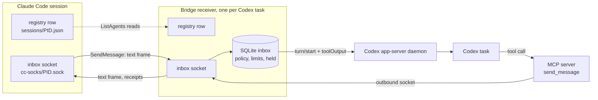

# Claude UDS Bridge

A Codex plugin that lets Codex tasks and Claude Code sessions message each other on one machine.

Claude Code lists and messages its other sessions through its own local registry. This plugin registers each Codex task in that registry, so Claude finds the task with `ListAgents` and writes to it with `SendMessage`. Claude needs no flags, plugins, or launchers. A bundled MCP server gives the Codex side `list_sessions` and `send_message`. Messages travel over Unix domain sockets in private per-user directories.

## Requirements

- Stock Codex with its shared local app-server daemon. CLI tasks on the daemon and desktop tasks it owns work. Older desktop tasks use the desktop IPC fallback. CLI sessions started with `--no-daemon` have no inbox. Real-runtime checks cover Codex 0.159.0, 0.159.2, and 0.159.3.
- macOS or Linux.
- Claude Code 2.1.224 or later, the first release with [cross-session messaging](https://code.claude.com/docs/en/cross-session-messaging).
- Bun on your `PATH`.

## Install

```bash
codex plugin marketplace add LeonKohli/claude-uds-bridge
codex plugin add claude-uds-bridge@leonkohli
```

The ByMedion fork supports Desktop stream versions 11 and 13, adds receiver diagnostics and recovery, and uses steering delivery only. Other stream versions are rejected. See [Desktop compatibility](plugins/claude-uds-bridge/DESKTOP-COMPATIBILITY.md) for the evidence and limits.

To install this fork from a local checkout:

```bash
codex plugin marketplace add /absolute/path/to/claude-uds-bridge
codex plugin add claude-uds-bridge@leonkohli
```

The fork keeps the upstream marketplace name `leonkohli`, so the plugin retains its existing identity when its source changes to the local checkout. Restart Codex after updating an already loaded plugin.

If `leonkohli` is already configured from another source, run `codex plugin marketplace remove leonkohli` before adding the local checkout.

The plugin is not in the public Plugin Directory. As of 2026-10-03, OpenAI's [submission rules](https://developers.openai.com/plugins/deploy/submission) reject plugins with lifecycle hooks and accept only hosted HTTPS MCP servers. This plugin needs a `SessionStart` hook and a local MCP server, because the sockets and registry it uses live on your machine. It installs through its own marketplace until those rules change.

Codex ignores plugin hooks until you trust them. Open the plugin in Codex, review the two hooks, and confirm both. Then open a new task. Tasks that were already open keep running without the hooks.

A task registers when its `SessionStart` hook runs, which Codex does on the first turn. A fresh chat with nothing typed stays invisible to Claude. See [STARTUP.md](plugins/claude-uds-bridge/STARTUP.md).

## Check that it works

In the Codex task, ask for the bridge status. The `status` tool reports a `replyAddress` and a `transport` of `app-server` or `desktop`. A `null` address means the receiver is inactive. Check hook trust and the hook result.

In Claude Code, run `/list-agents`. The task appears as `codex-<directory>-<suffix>`. Ask Claude to message it.

## How a message arrives

A message steers the task's active turn, or starts a turn when the task is idle. A running tool is never interrupted. The bridge marks the text as peer input. It grants no approval, and the task's own permissions still apply.



The app-server transport uses `turn/start` with `toolOutput`, which starts or joins a turn at tool authority. The bridge reads existing settings and leaves approval requests to your UI. If the observer connection drops, status and permissions are `unknown` while the bridge reconnects for up to 30 seconds. If recovery fails, the receiver exits. A lost delivery acknowledgement stays `unknown` and is never resent.

`list_sessions` reports advertised `deliveryModes` and `bridgeVersion`. Only `steer` is available; queue delivery was withdrawn. `send_message` addresses a peer by `sessionId`, not by name; ambiguous registrations are refused.

## Message delivery

Messages use steering: join the active turn, or start one when idle. No delivery marker is required. The optional compatibility argument accepts only `delivery: "steer"`; old queue requests are rejected before sending. The receiver also refuses `[bridge:queue]` and wire `priority: "later"`, including legacy held requests on release, rather than silently steering them.

Queue delivery was withdrawn in fork 0.2.8 after real use exposed invisible pending answers and missing sender edit/cancel controls. See [TODO](TODO.md#revisit-queue-delivery) for the problems and requirements before reconsidering it. Previously admitted queue records retain their IDs/input correlation; the rollback neither replays them as steering nor edits native queued work.

The bridge attaches a short delivery guide to the first ordinary outgoing message to each Claude session, inside that same message. The current guide explains ordinary steering delivery and permitted compact requests. Its revision is independent of the plugin version and increases only when the guide changes. Tracking is shared across Codex chats in `plugin-state/claude-uds-bridge/delivery-help.sqlite`, keyed by the canonical Claude profile directory and session ID. A resumed session ID keeps its record; a new session ID receives the guide again. Codex recipients and control-only idle subscriptions do not receive it.

The record confirms a successful send, not that Claude read or retained the guide. Concurrent sends reserve one guide attempt; another ordinary message can proceed while that attempt is pending. A crashed attempt's reservation expires after 20 seconds. A failed or uncertain send can leave the guide due for a later ordinary message, but the bridge never resends the original message automatically or creates an extra onboarding turn. If the guide would exceed the serialized size cap, the original message is sent unchanged and the guide is deferred. Unavailable guide bookkeeping also leaves the original send intact.

## Request context compaction from Claude

Choose `bridge-compact-access` from the `/` skill menu (or invoke `$claude-uds-bridge:bridge-compact-access`) to open compact permissions immediately. This short skill still runs the model; the permission choice stays in the native human dialog. Use `compact_access` to allow a selected Claude session in this chat, or enable profile-wide full trust for any authenticated local Claude in all present and future active Codex chats. Access is off by default. Full trust applies to receivers 0.2.10+; switching back to per-chat mode preserves individual grants. The existing inbox, authentication and idle checks still apply. Claude can then send exactly `[bridge:compact]` with native SendMessage. The bridge waits for a quiet idle boundary and reports `compact_result` separately; Claude should await completed before scheduling another task. Compact does not renew the 100-send budget, and one outgoing result notice counts toward it. See [compaction and native API limits](plugins/claude-uds-bridge/COMPACTION.md).

## Diagnose and recover a receiver

`status` reports `pluginVersion`, `receiverVersion`, `transportPath`, and the last receiver startup result. `diagnose` also probes this chat's transport without submitting input. It distinguishes missing/refused sockets, initialization timeouts, and unsupported stream versions.

Run `recover_receiver` to restore this current chat even when its recorded lifecycle is inactive, or to replace an older receiver. Replacement requires held/unread/pending input, idle subscriptions and compact requests to be resolved; upgrade_blocked reports what remains. It verifies a live Codex owner, directory and permissions, and checks the enabled trusted hook through the official read-only `hooks/list` API. It preserves held messages/deadlines, policy and the spent send budget; it never edits hook trust or loads an unidentified chat. See [receiver recovery](plugins/claude-uds-bridge/RECEIVER-RECOVERY.md) for the trust scope and failure cases.

Desktop observers now retry transient disconnects for up to 30 seconds, keeping status and permissions unknown until a fresh snapshot arrives. Discovery can try the known per-user legacy socket after a missing/refused primary endpoint, with the same ownership, private-directory, thread-owner, and stream checks. An incompatible IDE router requires resolving the router conflict separately; consult [IPC troubleshooting](plugins/claude-uds-bridge/IPC-TROUBLESHOOTING.md) and the local machine guidance before changing or restarting another application.

## Control what arrives

The receive setting belongs to one task. When the permission modes of sender and receiver differ, a native dialog opens, also between turns. Held text reaches the model only after you release it.

| Setting | Behavior |
| --- | --- |
| `default` | Accept a matching permission mode, hold a differing one. Without a sender mode, accept only `prompting`. |
| `accept` | Accept everything and release held messages. |
| `hold` | Hold without expiry until an accepting setting applies or the session ends. |
| `refuse` | Drop messages and discard idle subscriptions. |

A message held by the mode comparison expires after 5 minutes. You set the expiry to `60s`, `5m`, `10m`, or `never` in the `inbox` dialog.

The sender sees Claude's status notices, among them `held`, `delivered`, `denied`, and `expired`. `delivered` means a held message was released. Ordinary acceptance sends no receipt. The `status` tool keeps Claude's explanation as `status_reason`.

## MCP tools

| Tool | Use |
| --- | --- |
| `list_sessions` | List IDs, names, agent kinds, advertised delivery modes, bridge versions, directories, status, and start time. |
| `send_message` | Send ordinary text with steering delivery. Set `notify_when_idle` for one idle notice. |
| `status` | Show the receiver and recent transport outcomes. |
| `diagnose` | Show versions, startup errors, and transport reachability without submitting input. |
| `recover_receiver` | Restore this current chat receiver after native context and hook-trust checks. |
| `compact_access` | Open human settings for individual chat grants or profile-wide full trust for compact. |
| `inbox` | Open a dialog where you set the receive policy and hold expiry, or review the oldest held message. |

## Limits

- One message may reach 1,048,576 serialized characters. The sender refuses more before writing.
- A burst of 30 messages to one agent exhausts the budget. It refills one message every two seconds.
- At most 100 messages stay held and 50 accepted messages wait for Codex.
- `socket-written`, `accepted`, `started`, and `steered` report transport progress; old `queued` records remain historical. A model reply is a separate event.
- Idle subscriptions fire once and last at most 12 hours.
- The bridge refuses attachments and says why. Send a shared path as text.
- The bridge does not lock files. Agree on file ownership before two agents edit one repository.
- App-server delivery uses the experimental `toolOutput` API. An incompatible runtime fails delivery; the bridge does not guess another protocol.
- Codex has no loaded-only subscription. A task that closes between the bridge's loaded check and `thread/resume` can be resumed by the observer. Reads and delivery never resume tasks.

What is missing compared with Claude Code is in [PROTOCOL-COVERAGE.md](plugins/claude-uds-bridge/PROTOCOL-COVERAGE.md). How other Codex and MCP bridges differ is in [COMPARISON.md](plugins/claude-uds-bridge/COMPARISON.md).

Fork 0.2.6 supports native Claude local-chain compaction for authenticated local senders. Each Codex chat has 100 automatic text sends shared across peers and persistent across MCP/receiver restart. A confirmed new human input renews the allowance once; peer replies, tool results and idle notices do not. `status.automaticMessageBudget` shows the remaining allowance. Legacy/unverified peers retain the earlier hop limits. See the [local-dialogue contract and evidence](plugins/claude-uds-bridge/HOP-CHAINS.md).

## Skills

- [bridge-compact-access](plugins/claude-uds-bridge/skills/bridge-compact-access/SKILL.md) is bundled with the plugin and opens the compact-permissions form from the `/` skill menu.
- [codex-claude-bridge](plugins/claude-uds-bridge/skills/codex-claude-bridge/SKILL.md) is bundled alongside the compact-permissions skill. It covers the messaging workflow and receiver recovery; tool descriptions carry per-call rules. Technical references are part of the plugin. Machine-specific preferences stay in local guidance.

## Development

Install dependencies once in the package directory:

```bash
cd plugins/claude-uds-bridge
bun install --frozen-lockfile
```

The root [AGENTS.md](AGENTS.md) records the development workflow and known mistakes. From the repository root:

```bash
bun scripts/check.ts docs
bun scripts/check.ts focused test/receiver-upgrade.test.ts test/compact-access-mcp.test.ts
bun scripts/check.ts release --native
bun scripts/bump-version.ts patch --dry-run
bun scripts/verify-installed.ts --host
```

The scripts derive paths from their own location. From any other working directory, pass the absolute path to the script instead. They use the repository's Bun dependencies; no personal Codex skill or version-specific helper is required.

- `check.ts docs`: whitespace, manifest name/version consistency and packaged skill frontmatter/links. `focused` adds source/developer-script type checks and the explicit test files. `release` runs the existing full suite, compares a temporary build with committed bundles and tests the compiled MCP. `--native` also runs the Codex app-server/local-model-stub harness; without it the script explicitly reports that check as skipped. Checks do not rewrite bundles.
- `bump-version.ts`: accepts `patch`, `minor`, `major` or an explicit higher `X.Y.Z`. `--dry-run` reports the plan without writing. A real run updates both manifests and builds bundles; a failed build rolls back its manifest edits. Inspect the resulting diff and commit the version separately. The script does not commit, push or install.
- `verify-installed.ts`: checks the source version in the default CODEX_HOME marketplace cache, or accepts `--installed-root PATH` from the installer. It compares runtime files, skills and references, then opens MCP in a temporary isolated profile. `--host` additionally reports read-only hook metadata for the repository cwd. It does not activate a receiver, change settings or grant hook trust. Check the live chat with MCP status/diagnose separately.

The plugin runs the bundled `dist/server.js` and `dist/hook.js`, and CI fails when they lag `src/`. Run `bun run build` after changing `src/`. Set a new `version` in `package.json` and `.codex-plugin/plugin.json` for every release, because Codex caches an installed plugin by version. `bun run test:native` starts the installed Codex binary in a temporary home with a local model stub. See [Testing](plugins/claude-uds-bridge/PROTOCOL-COVERAGE.md#testing) for its modes and environment variables.

## License

MIT. See [LICENSE](LICENSE).
